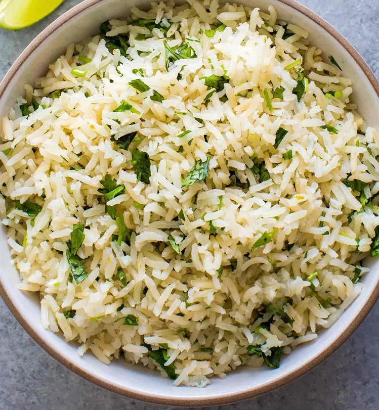

---
extends:
    web: _layouts.post
    api: _layouts.api.post
section: content
title: সিলান্ট্রো লাইম রাইস
subtitle: ধনে পাতা আর লেবুর সুগন্ধি সিলান্ট্রো লাইম রাইসের রেসিপি
excerpt: ধনে পাতা আর লেবুর সুগন্ধি সিলান্ট্রো লাইম রাইসের রেসিপি
metaImage: "/assets/images/recipes/cilantro-lime-rice.jpg"
date: "2026-11-09"
categories: ["নিরামিষ"]
servings: 3
prepMinutes: 25
---

সাধারণ ভাতের বদলে একটু অন্যরকম স্বাদ চাইলে খুব সহজেই এই মেক্সিকান রাইস ডিসটা তৈরি করতে পারেন। চলুন রেসিপিটা দেখে নেই।

## উপকরণ

- বাসমতি চাল (১ কাপ)
- পানি (১ কাপ ৩/৪ কাপ)
- বাটার বা ঘি (১ টেবিল চামচ)
- জিরা (১/২ চা চামচ)
- কাঁচামরিচ (১ টি, চিরে নেওয়া)
- লবন (স্বাদমতো)
- ধনে পাতা (১ মুঠো বড়)
- লেবুর রস (১ টেবিল চামচ)
- লেবুর খোসা কুড়ানো (১ চা চামচ)

## রন্ধনপ্রণালী

প্রথমেই চাল কয়েকবার পানিতে ধুয়ে নিন, যতক্ষণ না পানি পরিষ্কার হয়। এরপর চাল ১৫ মিনিট পানিতে ভিজিয়ে রাখুন, তারপর পানি ঝরিয়ে নিন।

একটা পাত্রে তেল বা মাখন গরম করে জিরা আর কাঁচামরিচ দিন। জিরা ফুটে উঠলে ভেজানো চাল দিয়ে এক মিনিট নেড়ে ভাজুন। এবারে এতে পানি আর লবন দিয়ে ফুটিয়ে নিন।

পানি ফুটে উঠলে আঁচ কমিয়ে ঢেকে দিন। ১২–১৫ মিনিট পর চাল সিদ্ধ হয়ে পানি শুকিয়ে এলে চুলা বন্ধ করে ৫ মিনিট ঢাকা অবস্থায় রেখে দিন।

ধনে পাতা আর লেবুর রস একসাথে কুচি করে কেটে নিন। এর সাথে লেবুর খোসা মিশিয়ে ভাতের উপর ঢেলে আলতো হাতে নেড়ে নিন, যাতে দানাগুলো না ভাঙে। গরম গরম পরিবেশন করুন।
