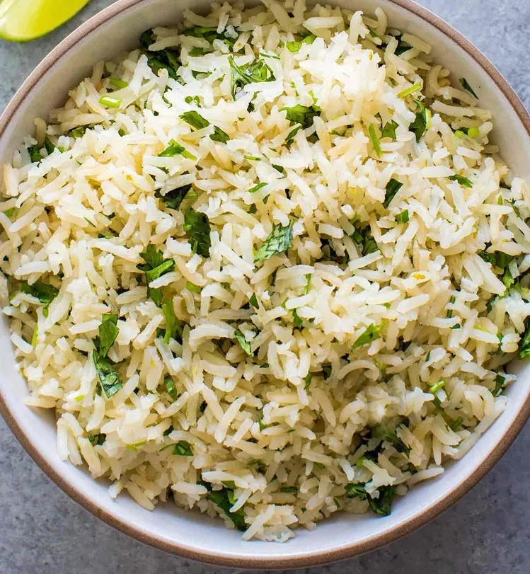

---
extends:
    web: _layouts.post
    api: _layouts.api.post
section: content
title: Cilantro Lime Rice
subtitle: A fragrant cilantro lime rice recipe with cilantro and lime
excerpt: A fragrant cilantro lime rice recipe with cilantro and lime
metaImage: "/assets/images/recipes/cilantro-lime-rice.jpg"
date: "2026-11-09"
categories: ["Vegetarian"]
servings: 3
prepMinutes: 25
---

If you want something different from plain rice, you can easily make this Mexican rice dish. Let's see the recipe.

## Ingredients

- Basmati rice (1 cup)
- Water (1 3/4 cups)
- Butter or ghee (1 tablespoon)
- Cumin seeds (1/2 teaspoon)
- Green chili (1, slit lengthwise)
- Salt (to taste)
- Cilantro (1 large handful)
- Lime juice (1 tablespoon)
- Lime zest (1 teaspoon)

## Method

Rinse the rice several times until the water runs clear. Soak the rice in water for 15 minutes, then drain.

Heat the butter or ghee in a pot. Add the cumin seeds and green chili. When the cumin sizzles, stir in the drained rice and fry for one minute. Add the water and salt, then bring to a boil.

When the water boils, lower the heat and cover the pot. After 12–15 minutes, the rice should be cooked and the water absorbed. Turn off the heat and keep the lid on for 5 minutes.

Finely chop the cilantro and mix it with the lime juice. Add the lime zest, then pour it over the rice and gently fold it in so the grains stay whole. Serve hot.
